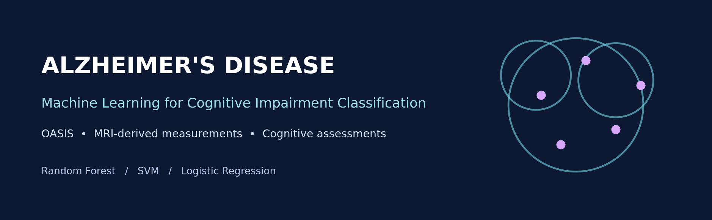
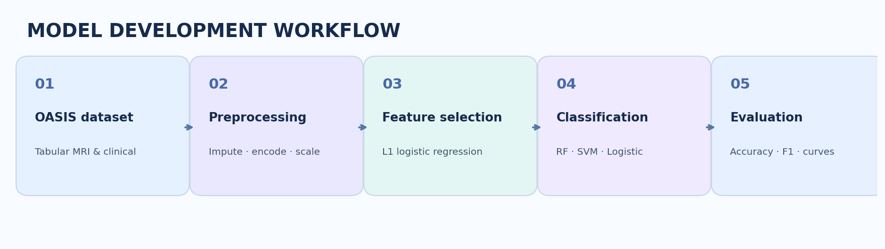

<div align="center">



# Predicting Alzheimer’s Disease Using Brain Imaging and Genetic Data

**A machine-learning exploration of cognitive impairment classification and MMSE score estimation using the OASIS cross-sectional dataset.**

   

</div>

## Overview

Alzheimer’s disease is a progressive neurological condition that affects memory and cognitive functioning. This project investigates whether **structured neuroimaging-derived and clinical measurements** can help machine-learning models distinguish cognitive impairment categories.

The notebook develops a **three-class classification pipeline** and separately compares regression models for estimating **Mini-Mental State Examination (MMSE)** scores. The broader project report discusses genetic information and PET imaging as potential multimodal inputs; **the supplied implementation uses tabular OASIS cross-sectional data, not raw PET scans or a demonstrated genetic-feature pipeline**.

## Workflow



1. **Load OASIS data** from the cross-sectional Excel worksheet.
2. **Clean data** by filling missing values in `Educ`, `SES`, `MMSE`, and `CDR` with column medians; remove `Delay`; save `oasis_cleaned.csv`.
3. **Prepare classification features** by encoding categorical fields, making an 80/20 stratified train/test split, and applying MinMax scaling.
4. **Select features** using L1-regularized logistic regression and `SelectFromModel`.
5. **Train and compare** Random Forest, support vector machine (SVM), and Logistic Regression classifiers, with grid-search tuning and learning-curve visualizations.
6. **Explore MMSE estimation** using Random Forest Regressor, SVR, and Linear Regression.

## Dataset and targets

**Source:** [OASIS — Open Access Series of Imaging Studies](https://www.oasis-brains.org/), cross-sectional dataset.

The notebook loads an Excel file with worksheet name `oasis_cross-sectional` and uses demographic, clinical, and MRI-derived tabular fields. It maps the **Clinical Dementia Rating (`CDR`)** into the following labels:

| CDR | Notebook label |
|---|---|
| `0.0` | No Impairment |
| `0.5` | Mild Impairment |
| `1.0` | Alzheimer's |

**Important:** These are the notebook's working class labels based on CDR; they should not be interpreted as independently confirmed clinical diagnoses. The regression target is **MMSE score at observation**, not longitudinal MMSE decline.

## Models and evaluation

| Task | Models | Evaluation |
|---|---|---|
| Cognitive impairment classification | Random Forest, SVM, Logistic Regression | Accuracy, precision, recall, F1-score, learning curves |
| MMSE score regression | Random Forest Regressor, Support Vector Regressor, Linear Regression | RMSE, R² |

The notebook includes hyperparameter search via `GridSearchCV` for classifiers and visualizations of predictions, learning curves, and feature correlations. For numerical results, consult the notebook outputs and accompanying report rather than assuming a single headline accuracy.

## Repository files

- `MiniProject_PredictingAlzeimer_Final.ipynb` — primary analysis notebook (supplied project file).
- `Mini_Project_Report.pdf` — project write-up (supplied report).
- `assets/project-banner.png` — README header graphic.
- `assets/ml-workflow.png` — workflow illustration.
- `oasis_cleaned.csv` — generated by the preprocessing notebook cell (not necessarily tracked).

> File names in your GitHub repository may differ; update the links and names above to match the committed files.

## Run locally

1. Clone the repository:
   ```bash
   git clone https://github.com/janhavi502/Predicting-Alzheimer-s-Disease-Using-Brain-Imaging-and-Genetic-Data-.git
   cd Predicting-Alzheimer-s-Disease-Using-Brain-Imaging-and-Genetic-Data-
   ```
2. Install the notebook's main dependencies:
   ```bash
   pip install notebook pandas numpy scipy scikit-learn matplotlib seaborn openpyxl
   ```
3. Obtain the **OASIS cross-sectional dataset** from its official source, subject to its access and use terms.
4. Open the notebook:
   ```bash
   jupyter notebook MiniProject_PredictingAlzeimer_Final.ipynb
   ```
5. **Before running**, replace the hard-coded local Excel path in the data-loading cell with the location of your downloaded dataset. Ensure the workbook includes the `oasis_cross-sectional` sheet. Run cells in order; preprocessing creates `oasis_cleaned.csv`.

## Interpretation and limitations

- **Cross-sectional observations:** This work estimates current impairment categories and MMSE scores; it does **not** establish future disease progression.
- **No raw-image or genomic modeling demonstrated:** The notebook operates on structured dataset columns; MRI/PET image processing and genetic integration remain possible extensions.
- **Potential target leakage in regression:** The notebook creates regression predictors from `X`, which includes `MMSE`, while also setting `MMSE` as the regression target. **Remove `MMSE` from regression features and rerun evaluation before interpreting RMSE/R².**
- **Feature selection validation:** For stronger generalization estimates, fit feature selection inside a cross-validation pipeline rather than once before tuning.
- **Clinical context:** This is an educational/research project, **not a validated diagnostic system**.

## Future directions

- Build leakage-safe end-to-end scikit-learn pipelines and evaluate on held-out cohorts.
- Add calibrated probabilities, class-wise metrics, confusion matrices, and SHAP explanations where appropriate.
- Explore longitudinal datasets to model actual MMSE change over time.
- Investigate imaging and genetic modalities when corresponding data and processing are available.

## Reference

[OASIS: Open Access Series of Imaging Studies](https://www.oasis-brains.org/)

---

<div align="center"><sub>Exploring interpretable machine learning for neurological research · For research and educational use only</sub></div>
